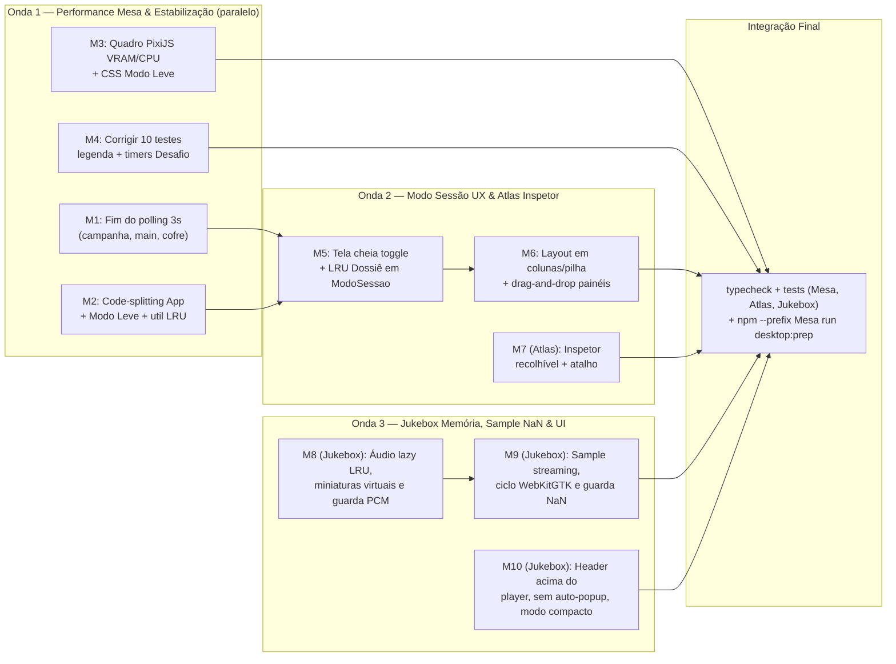

# Plano Técnico — Performance do Mesa, Modo Sessão, Inspetor do Atlas e Correções Críticas do Jukebox

Este documento é um plano técnico detalhado para execução (inclusive em ondas paralelas por subagents) visando:
1. Otimizar a **performance do Mesa** para computadores de porte menor (CPU, RAM, VRAM e compositing GPU).
2. Corrigir o **Modo Sessão** do Mesa (botão de tela cheia que não alterna, rearranjo intuitivo de janelas e empilhamento vertical em colunas).
3. Tornar o **Inspetor do Atlas** (`Mapa / Seleção / Histórico`) recolhível para liberar largura útil para o mapa.
4. Corrigir os bugs críticos do **Jukebox** no navegador e no app desktop (Tauri/WebKitGTK no Linux): crash OOM do sistema ao carregar pastas com ~500 músicas, falha de reprodução / `NaN` no Sample Preset, e overlay do player bloqueando cliques no menu superior em janelas pequenas.

---

## Decisões Já Aprovadas pelo Usuário

Todas as decisões de arquitetura abaixo foram confirmadas explicitamente pelo usuário e não precisam ser reperguntadas durante a execução:

1. **Projetos irmãos autorizados:** É permitido editar arquivos fora de `Mesa/` especificamente em:
   - `Atlas/`: apenas o necessário para tornar o Inspetor recolhível (`M7`).
   - `Jukebox/`: correções de memória/OOM, streaming do Sample Preset, ciclo WebKitGTK/`NaN` e posicionamento do player (`M8`–`M10`).
2. **Teto de iframes vivos do Dossiê no Modo Sessão (`M2` / `M5`):** Utilizar **LRU de até 2 iframes vivos** no modo normal e **1 iframe** quando o **Modo Leve** estiver ativo, desmontando automaticamente as fichas mais antigas e oferecendo botão `×` para fechamento manual nas abas.
3. **Estratégia de áudio para pastas grandes no WebKitGTK/Tauri (`M8` / `M9`):** Resolver primeiro 100% no modelo web/lazy-LRU (que beneficia navegador e desktop) com diagnóstico explícito de erro de mídia no player. Somente adicionar streaming nativo via `Mesa/src-tauri/` caso o teste real com a pasta `VAESEN` (~500 músicas) ainda apresente falha de seek/reprodução no WebKitGTK.
4. **Escopo deste lote:** Executar **`M1`–`M10`** agora. A ficha **`M11`** (quebra estrutural dos monolitos do Mesa) fica registrada como opcional para uma rodada futura dedicada.

---

## Regras Obrigatórias de Execução

Antes de editar qualquer arquivo, leia e respeite integralmente:
- `Projects/AGENTS.md`
- `Mesa/AGENTS.md`
- `Atlas/AGENTS.md` (para `M7`)

Pontos críticos a observar em todo o lote:
1. **Pureza do domínio (`Mesa/AGENTS.md`):** Tudo em `Mesa/src/dominio/` deve permanecer 100% puro (zero dependências de Preact, signals, DOM, `window`, IndexedDB ou rede).
2. **Contrato `mesa-core`:** Nunca editar manualmente `vendor/mesa-core/`. Se algum contrato compartilhado precisar mudar (não previsto neste plano), atualizar a fonte em `Atlas/mesa-core/` e sincronizar pelo fluxo oficial.
3. **Commits atômicos:** Fazer **1 commit atômico por mudança lógica independente** (`git add <arquivos da ficha>`), nunca um commit único misturando várias fichas ou repositórios.
4. **Padrão de commits:** Seguir `git log -n 10 --oneline` do respectivo repositório (`Mesa` e `Atlas` usam prefixos `(performance)`, `(bug fix)`, `(feature)`, `(test)`, `(docs)`, `(chore)` seguidos de descrição objetiva em inglês minúsculo; em `Jukebox`, manter estilo consistente com o histórico recente, preferencialmente inglês minúsculo com categoria entre parênteses ou descritivo direto). Nunca adicionar `Co-authored-by` e nunca alterar `user.name`/`user.email`.
5. **Limite de 45 commits/dia e ordem cronológica (`Projects/AGENTS.md` regra #5):**
   - Antes de cada commit, contar os commits do usuário por data em **todos** os repositórios de `Projects/`:
     ```bash
     for r in */; do [ -d "$r.git" ] && git -C "$r" log --all --author="$(git -C "$r" config user.email)" --format=%ad --date=format:%Y-%m-%d; done | sort | uniq -c | tail -15
     ```
   - Verificar também a data mais recente do repositório alvo com `git -C <repo> log --all --format=%aI | sort | tail -1`.
   - Se a data já tiver 45 ou mais commits (ou for anterior ao último commit do repositório), avançar para o próximo dia disponível (`GIT_AUTHOR_DATE` e `GIT_COMMITTER_DATE`), mantendo estritamente a ordem cronológica.
6. **Validação obrigatória antes de concluir:**
   - `Mesa`: `cd Mesa && npm run typecheck && npm test` (e `npm run build` para validar chunks).
   - `Atlas`: `cd Atlas && npm run typecheck && npm test`.
   - `Jukebox`: `cd Jukebox && node --test tests/*.test.mjs`.
   - **Desktop (`Projects/AGENTS.md` regra #6):** Ao concluir as alterações de código da plataforma, rodar `npm --prefix Mesa run desktop:prep` para atualizar `Mesa/dist-desktop/`.
7. **Working tree pré-existente no `Mesa`:** No início deste planejamento havia 3 arquivos modificados não commitados no repositório `Mesa`:
   - `Mesa/src/dominio/estilo-do-quadro.ts`
   - `Mesa/src/dominio/insercao-quadro.ts`
   - `Mesa/src/dominio/legenda-do-quadro.ts`
   Antes de executar a ficha `M4` (testes de legenda), inspecionar `git -C Mesa diff` desses 3 arquivos e **não** descartar trabalho em andamento sem verificar.

---

## Diagnóstico Completo (Causas-Raiz Confirmadas no Código)

| Área | Sintoma / Risco | Arquivo e Linhas | Causa-Raiz Confirmada |
|---|---|---|---|
| **Mesa — Polling 3s** | Uso contínuo de CPU, IndexedDB e IPC em idle | `Mesa/src/main.tsx:57`, `Mesa/src/app/campanha.ts:100-120`, `Mesa/src/ui/ModoSessao.tsx:335-360`, `Mesa/src/app/cofre.ts:260-282` | `setInterval(reler, 3000)` dispara `atualizar()` a cada 3s quando a aba está visível. `atualizar()` executa 3 varreduras completas no IndexedDB (desserializando inclusive `Blob`s de retratos) e reatribui arrays novos incondicionalmente a `campanhas.value`, `entidades.value` e `ligacoes.value`. Isso dispara em cascata a cada 3s: `carregarFatos()` + RPCs `BroadcastChannel` (`jukebox.prontidao`, `atlas.prontidao`) no `ModoSessao`, leituras em `mesa-handouts-v1`, re-renders na coleção e reagendamento de `agendarSincronizacaoCofre` em disco. |
| **Mesa — RAM / WebGL em Sessão** | Memória e contextos WebGL crescem sem teto ao abrir fichas | `Mesa/src/ui/ModoSessao.tsx:62-63, 120-123` | `PainelDasFichas` acumula todo `fichaId` aberto em `abertas` e mantém `<iframe hidden>` montado indefinidamente sem nunca desmontar. Cada iframe do Dossiê carrega ~17,6 MB de JS + Three.js + contexto WebGL + IndexedDB + BroadcastChannel. |
| **Mesa — Boot pesado** | Parse/memória inicial alta mesmo fora do Quadro/Desafios | `Mesa/src/ui/App.tsx:1-23` | `App.tsx` importa estaticamente `Quadro` (2.662 LOC + PixiJS 8 + Tiptap/ProseMirror), `PainelDesafios` (2.355 LOC), `ModoSessao`, `Entidades` e `MesaOnline`, ao contrário de `Casca` que já usa `import()` sob demanda. |
| **Mesa — Quadro PixiJS VRAM/CPU** | Engasgos no zoom e pressão de VRAM em GPUs integradas | `Mesa/src/ui/quadro/pixi/cache-imagens-pixi.ts:8`, `Mesa/src/app/imagens-quadro.ts:13-35`, `Mesa/src/ui/quadro/pixi/render-itens.ts:673`, `Mesa/src/ui/quadro/pixi/viewport-quadro.ts:69` | `MAX_COMPLETAS_PADRAO = 120` permite até 120 texturas full-res (até 4096×4096) e `miniaturas` não possui limite/evicção LRU. `cacheUrls` em `imagens-quadro.ts` acumula `blob:` URLs sem LRU enquanto o quadro estiver aberto. Em `render-itens.ts:673`, títulos de `moldura` usam chave `` `${item.titulo}:${Math.round(invZoom * 100)}` ``, re-rasterizando canvas/textura a cada tick de zoom do mouse. `viewport-quadro.ts:69` força `resolution: Math.min(2, dpr)` + `antialias: true`. Além disso, há 20+ regras `backdrop-filter: blur(...)` nas folhas CSS (custosas em WebKitGTK/Linux). |
| **Mesa — Testes quebrados** | 10 falhas pré-existentes em `npm test` (862/872) | `Mesa/src/dominio/legenda-do-quadro.ts:48-63`, `Mesa/tests/unit/{legenda-do-quadro,estilo-do-quadro,papeis-quadro,quadro-centrado}.test.ts` | A introdução da `LEGENDA_PADRAO` fixa quebrou asserções antigas nos 4 arquivos de testes unitários que esperavam comportamento "sem legenda" quando não havia seção explícita. |
| **Sessão — Tela Cheia** | Botão `⛶` entra em tela cheia mas não sai (só `Esc` sai) | `Mesa/src/ui/ModoSessao.tsx:362, 465` | `telaCheia` só executa `el?.requestFullscreen?.()` e nunca verifica `document.fullscreenElement` para chamar `document.exitFullscreen()`, nem registra listener de `fullscreenchange` para refletir o estado no botão. |
| **Sessão — Layout rígido** | Difícil rearranjar janelas; painéis espremidos na horizontal | `Mesa/src/dominio/layout.ts`, `Mesa/src/ui/ModoSessao.tsx:459-472`, `Mesa/src/ui/estilo.css:302-320` | O layout atual só representa uma fila horizontal em ordem fixa (`['atlas', 'fichas', 'jukebox', 'diario', 'quadro']`). Não há drag-and-drop nos cabeçalhos `.painel-topo`, não há botão rápido de fechar (`×`) no cabeçalho, nem suporte a **empilhamento vertical em colunas** (ex.: Atlas grande à esquerda + Fichas/Jukebox empilhados à direita). |
| **Atlas — Inspetor fixo** | Impossível recolher `Mapa / Seleção / Histórico` | `Atlas/src/ui/estilo.css:169, 465`, `Atlas/src/ui/Editor.tsx:196-221`, `Atlas/src/ui/Inspetor.tsx:1103-1115` | `.editor` trava `grid-template-columns: auto minmax(0, 1fr) 312px;`. Dentro da largura lógica de `900px` do Modo Sessão no Mesa, o Inspetor de `312px` consome **35% da área do mapa** sem botão nem atalho para recolher. |
| **Jukebox — OOM Crash (500 músicas)** | Carregar pasta `VAESEN` em `MUSICAS 2` trava o PC inteiro | `Jukebox/upload-song.js:1483-1579`, `Jukebox/player.js:205-222`, `Jukebox/player.js:3435-3438` | Sem `showDirectoryPicker` no Tauri/WebKitGTK, `loadPreset()` usa `<input webkitdirectory>` e `populatePresetFromFileHandles()` + `addSongToPlayer()` criam eagerly **500 `URL.createObjectURL(audioFile)` + 500 `URL.createObjectURL(thumbnailFile)` + 500 `new Audio()`** (= 500 pipelines GStreamer/descritores abertos ao mesmo tempo). Além disso, `generateWaveformActual()` lê o MP3 inteiro em `ArrayBuffer` e chama `decodeAudioData()`, expandindo faixas de 1h (~25 MB) para **~650 MB de Float32 PCM** na RAM. |
| **Jukebox — Sample Preset `NaN`** | Imagens carregam, áudio não toca e barra exibe `NaN` | `Jukebox/upload-song.js:1644-1684`, `Jukebox/player.js:166, 1848-1854, 1911, 2024, 3569` | `Jukebox/sample/` totaliza **641,5 MB** de MP3. `loadSamplePreset()` faz `fetch()` eager dos 641,5 MB para `Blob`/`File`/`blob:` URL na RAM (~1,3 GB de pico), falhando no pipeline GStreamer/WebKitGTK (agravado por `audio.currentTime = 0` com `readyState === 0` em `player.js:166`), deixando `audio.duration = NaN`. `formatTime()` (`player.js:1848-1854`) não checa `Number.isFinite` e exibe `NaN:NaN` na barra/tooltip. |
| **Jukebox — Overlay no menu** | Overlay do player cobre botões do topo em janela pequena | `Jukebox/style.css:141, 345-360, 2154-2162`, `Jukebox/player.js:1537-1558` | `.top-header` tem `z-index: 20`, enquanto `.player-container` tem `position: fixed; top: 4px; z-index: 21` (em `@media (max-width: 620px)`, que ativa exatamente no painel de `520px` da sessão!). Pior: `player.js:1537-1558` escuta `document.addEventListener('pointermove', ...)` e abre o overlay **160 ms após o cursor passar por cima da área**, bloqueando cliques em *Manage Songs / Upload Song / Load Preset*. |

---

## Mapa de Ondas e Dependências



> [!NOTE]
> - **Propriedade disjunta na Onda 1:** `M1`, `M2`, `M3` e `M4` não compartilham arquivos entre si — podem rodar **100% em paralelo**.
> - **Onda 2:** `M5` e `M6` editam `Mesa/src/ui/ModoSessao.tsx`, logo devem rodar em sequência (`M5` → `M6`) ou pelo mesmo worker em 2 commits atômicos separados. `M7` atua exclusivamente em `Atlas/` e pode rodar em paralelo com tudo.
> - **Onda 3:** `M8` e `M9` editam `Jukebox/upload-song.js` e `Jukebox/player.js`, logo `M9` deve rodar após `M8` (ou no mesmo worker em commits sequenciais). `M10` também ajusta um bloco em `Jukebox/player.js` (`pointermove` lines 1537-1558) além de `style.css`/`index.html` — rodar `M10` após `M9` (ou isolar claramente o trecho) garante zero conflitos de merge.

---

## Detalhamento das Fichas (Subagent-Ready)

---

### Onda 1 — Performance do Mesa & Estabilização

#### Ficha `M1` — Eliminar polling destrutivo de 3s e syncs no-op do Cofre
- **Repositório alvo:** `Mesa`
- **Arquivos:**
  - `Mesa/src/app/campanha.ts`
  - `Mesa/src/main.tsx`
  - `Mesa/src/app/cofre.ts`
  - `Mesa/tests/unit/campanha-sync.test.ts` (novo)
- **Mudanças exatas:**
  1. **Detecção estrutural de mudanças (`Mesa/src/app/campanha.ts`):**
     - Criar helper determinístico que calcula uma assinatura leve para `campanhas`, `entidades` e `ligacoes` (usando `id`, `atualizadaEm`/`atualizadoEm`, `nome`, `visivel`/`estado` ou campos equivalentes de versionamento sem serializar `Blob`s binários).
     - Em `atualizar()`: adicionar lock single-flight (`atualizacaoEmVoo`) para impedir execuções concorrentes sobrepostas e **só reatribuir** `campanhas.value`, `entidades.value` ou `ligacoes.value` quando a respectiva assinatura realmente tiver mudado (comparando também a referência/ID de `ativaId`).
  2. **Substituir polling de 3s por atualização orientada a eventos (`Mesa/src/main.tsx`):**
     - Trocar `setInterval(reler, 3000)` por:
       - Listeners em `visibilitychange` (ao voltar para visível), `focus` da janela e evento `storage`;
       - Disparo de `atualizar()` ao receber mutações relevantes via `BroadcastChannel` (`mesa-core` / canal da plataforma);
       - Fallback de segurança muito mais espaçado (ex.: `30_000 ms`, nunca rodando com `document.visibilityState === 'hidden'`).
  3. **Evitar escrita no-op no Cofre (`Mesa/src/app/cofre.ts`):**
     - Em `agendarSincronizacaoCofre(campanha, entidades, ligacoes)`, computar assinatura leve do conjunto e ignorar a agenda/gravação quando for idêntica à última sincronização bem-sucedida para a mesma campanha/pasta vinculada.
- **Testes / Critérios:**
  - Teste unitário em `Mesa/tests/unit/campanha-sync.test.ts` garantindo que duas leituras com os mesmos dados preservam a identidade referencial dos arrays/signals (ou assinatura estável) e não disparam cascatas desnecessárias.
- **Commit atômico:** `(performance) stop redundant 3s indexeddb polling and no-op vault syncs`
- **Verificação:** `cd Mesa && npm run typecheck && npm test`

---

#### Ficha `M2` — Code-splitting de telas pesadas + Preferência "Modo Leve" + utilitário LRU puro
- **Repositório alvo:** `Mesa`
- **Arquivos:**
  - `Mesa/src/ui/App.tsx`
  - `Mesa/src/app/desempenho.ts` (novo)
  - `Mesa/src/dominio/lru.ts` (novo — 100% puro)
  - `Mesa/tests/unit/lru.test.ts` (novo)
- **Mudanças exatas:**
  1. **Utilitário LRU puro (`Mesa/src/dominio/lru.ts`):**
     - Implementar funções puras testáveis para gerenciar ordem de acesso com teto configurável:
       - `registrarAcessoLru(ordemAtual: readonly string[], id: string, limite: number): { ordem: string[]; despejados: string[] }`
       - `removerDaLru(ordemAtual: readonly string[], id: string): string[]`
     - Será reutilizado tanto pelo painel de fichas do Modo Sessão (`M5`) quanto por caches.
  2. **Preferência "Modo Leve" (`Mesa/src/app/desempenho.ts`):**
     - Persistir preferência `localStorage['mesa:modo-leve']` (`'1'` / `'0'` / ausente).
     - Quando não houver escolha explícita do usuário, aplicar heurística conservadora via `navigator.deviceMemory` (`<= 4`) ou `navigator.hardwareConcurrency` (`<= 4`) — com fallback `false` se as APIs não existirem (e seguro para ambiente Node/vitest).
     - Expor signal `modoLeve`, `definirModoLeve(v: boolean)` e aplicar classe `modo-leve` em `document.documentElement.classList` via `effect`.
     - Expor um toggle discreto na barra/configuração de aparência em `App.tsx` (com tooltip explicando: reduz resolução do canvas, limite de cache e efeitos `blur` para PCs modestos).
  3. **Code-splitting em `Mesa/src/ui/App.tsx`:**
     - Substituir imports estáticos de telas pesadas (`Quadro`, `PainelDesafios`, `ModoSessao`, `MesaOnline`, e se viável `OverlayDesafio`) por carregamento dinâmico sob demanda (`import()` + componente wrapper com estado de carregamento leve), seguindo o padrão já usado para `Casca` em `App.tsx`.
     - Garantir que ao abrir na visão geral da campanha/coleção, o bundle de PixiJS 8 + Tiptap/ProseMirror do Quadro não seja baixado nem parseado até que o usuário abra um Quadro.
- **Testes / Critérios:**
  - `Mesa/tests/unit/lru.test.ts` cobrindo limite 1, limite 2, promoção de item já existente para o topo dos recentes e ordem exata dos `despejados`.
  - `npm run build` no `Mesa` deve gerar chunks separados para o Quadro/ModoSessao.
- **Commit atômico:** `(performance) lazy-load heavy screens and add low-end mode preference`
- **Verificação:** `cd Mesa && npm run typecheck && npm test && npm run build`

---

#### Ficha `M3` — Otimização de VRAM/CPU do Quadro PixiJS e Redução de `backdrop-filter`
- **Repositório alvo:** `Mesa`
- **Arquivos:**
  - `Mesa/src/ui/quadro/pixi/cache-imagens-pixi.ts`
  - `Mesa/src/ui/quadro/pixi/render-itens.ts`
  - `Mesa/src/ui/quadro/pixi/viewport-quadro.ts`
  - `Mesa/src/app/imagens-quadro.ts`
  - `Mesa/src/ui/estilo.css` (e demais CSS do `Mesa` apenas para bloco `:root.modo-leve`)
  - `Mesa/tests/unit/cache-imagens-pixi.test.ts` (novo ou ampliar se existir)
- **Mudanças exatas:**
  1. **Limites rígidos de VRAM e `blob:` URLs (`cache-imagens-pixi.ts` e `imagens-quadro.ts`):**
     - Em `cache-imagens-pixi.ts`: reduzir `MAX_COMPLETAS_PADRAO` de `120` para `48` no modo normal e `20` quando `modoLeve` estiver ativo; adicionar **evicção LRU também para `miniaturas`** (`240` normal / `100` Modo Leve), garantindo `texture.destroy(true)` ao despejar tanto completas quanto miniaturas.
     - Em `imagens-quadro.ts`: transformar `cacheUrls` em cache com teto LRU (ex.: `150` URLs), chamando `URL.revokeObjectURL(...)` para as URLs mais antigas despejadas (exceto se estiver em `carregandoUrls`).
     - Verificar `Mesa/src/ui/quadro/Quadro.tsx`: ao desmontar o componente `Quadro`, assegurar que `revogarImagensDoQuadro()` seja chamado se o quadro fechado liberou o canvas, evitando URLs órfãs na memória após sair da tela do Quadro.
  2. **Quantizar zoom nos títulos de `moldura` (`Mesa/src/ui/quadro/pixi/render-itens.ts:673`):**
     - Substituir a chave atual `` `${item.titulo}:${Math.round(invZoom * 100)}` `` por quantização discreta de `invZoom` (ex.: degraus logarítmicos `Math.round(Math.log2(invZoom) * 3)` ou degraus `[0.5, 0.75, 1, 1.4, 2, 2.8, 4, 6]`), evitando recriar canvas/textura Pixi em todo evento de `wheel`.
  3. **Resolução e GPU no `ViewportQuadro` (`Mesa/src/ui/quadro/pixi/viewport-quadro.ts:69`):**
     - Se `modoLeve` estiver ativo: iniciar `Application` do PixiJS com `resolution: 1`, `antialias: false`, `powerPreference: 'low-power'`. No modo padrão, limitar `resolution` a `Math.min(1.5, window.devicePixelRatio || 1)` em vez de `2` (reduz ~44% dos pixels sombreados em HiDPI sem perda perceptível em texto/cartões).
  4. **Modo Leve no CSS (`Mesa/src/ui/estilo.css` e folhas com `backdrop-filter`):**
     - Adicionar bloco `:root.modo-leve` desativando `backdrop-filter: none !important; -webkit-backdrop-filter: none !important;` (substituindo fundos translúcidos dependentes de blur por fundo opaco/semi-opaco leve) e reduzindo sombras/blur pesados em overlays e cartões.
- **Commit atômico:** `(performance) cap quadro vram caches, quantize frame title zoom, and add low-power css mode`
- **Verificação:** `cd Mesa && npm run typecheck && npm test`

---

#### Ficha `M4` — Estabilizar os 10 testes de legenda + higiene de timers em Desafios
- **Repositório alvo:** `Mesa`
- **Arquivos:**
  - `Mesa/tests/unit/legenda-do-quadro.test.ts`
  - `Mesa/tests/unit/estilo-do-quadro.test.ts`
  - `Mesa/tests/unit/papeis-quadro.test.ts`
  - `Mesa/tests/unit/quadro-centrado.test.ts`
  - `Mesa/src/jogar/OverlayDesafio.tsx` (apenas cleanup dos 3 `setInterval`)
- **Mudanças exatas:**
  1. **Investigar e corrigir as 10 falhas pré-existentes (`862/872`):**
     - Inspecionar o `git diff` atual nos 3 arquivos não commitados (`estilo-do-quadro.ts`, `insercao-quadro.ts`, `legenda-do-quadro.ts`) para entender o contrato exato da `LEGENDA_PADRAO` fixa.
     - Verificar caso a caso nos 4 arquivos de teste (`estilo-do-quadro.test.ts:66`, `legenda-do-quadro.test.ts:65,85,105,116,122,132,142`, `papeis-quadro.test.ts:136`, `quadro-centrado.test.ts:80`): se o comportamento novo em `dominio/` estiver correto, atualizar as expectativas dos testes (ou corrigir qualquer regressão genuína caso encontrada em `legenda-do-quadro.ts`).
  2. **Higiene de timers em `OverlayDesafio.tsx`:**
     - Auditar os 3 `window.setInterval(sortear, 75)` nas linhas ~1448, 2126 e 2413 de `Mesa/src/jogar/OverlayDesafio.tsx` e garantir `useEffect(() => () => { if (intervaloRef.current) clearInterval(intervaloRef.current); }, [])` no unmount de cada componente/bloco, evitando intervalos órfãos se o overlay fechar durante uma animação de rolagem.
- **Commits atômicos:**
  - `(test) align quadro legend unit tests with fixed gm default legend`
  - `(bug fix) clear dice roll intervals on challenge overlay unmount` (se aplicável)
- **Verificação:** `cd Mesa && npm run typecheck && npm test` (obrigatório: **0 falhas**, toda a suíte verde).

---

### Onda 2 — Modo Sessão UX & Inspetor Recolhível do Atlas

#### Ficha `M5` — Correção de Tela Cheia, LRU de Fichas (teto 2 / 1 Modo Leve) e Debounce de Fatos
- **Repositório alvo:** `Mesa`
- **Depende de:** `M1`, `M2`
- **Arquivo:**
  - `Mesa/src/ui/ModoSessao.tsx`
- **Mudanças exatas:**
  1. **Correção do botão Tela Cheia (`ModoSessao.tsx:362, 465`):**
     - Manter estado reativo `painelEmTelaCheia` atualizado por listener `fullscreenchange` no `document`:
       ```ts
       const atualizarTelaCheia = () => {
         const atual = document.fullscreenElement?.getAttribute('data-painel') as PainelId | null;
         painelEmTelaCheia.value = atual ?? null;
       };
       ```
     - No handler `alternarTelaCheia(id)`:
       - Se `document.fullscreenElement` existir e pertencer ao painel (`el` ou descendente, ou qualquer elemento em fullscreen): chamar `await document.exitFullscreen().catch(() => undefined)`.
       - Só chamar `await el?.requestFullscreen?.().catch(() => undefined)` quando `document.fullscreenElement` estiver nulo (ou se usuário clicar em outro painel enquanto outro estiver em fullscreen, fazer `exitFullscreen` antes de pedir `requestFullscreen`).
     - Atualizar ícone, `title` e `aria-label` do botão no cabeçalho do painel: mostrar `⛶` / *"Tela cheia"* quando normal e ícone claro de saída (ex.: `⤢` ou `✕`) + *"Sair da tela cheia"* + `aria-pressed={true}` quando ativo.
  2. **LRU de iframes do Dossiê (`PainelDasFichas`):**
     - Substituir a lista acumulativa infinita `abertas` por lista de abas abertas (metadados leves) separada da lista de **iframes vivos** gerenciada com `registrarAcessoLru` (de `M2`):
       - Limite padrão: **2 iframes montados simultaneamente**;
       - No **Modo Leve** (`modoLeve.value === true`): **1 iframe montado** (reutilizando/substituindo ao trocar de ficha).
     - Ao clicar em uma aba cuja ficha foi despejada da LRU, ela volta imediatamente a montar o `<iframe>` (e empurra a mais antiga para fora).
     - Adicionar botão `×` discreto nas abas de ficha para fechar a ficha manualmente e removê-la da LRU, liberando RAM/WebGL na hora.
  3. **Debounce + fingerprint de `carregarFatos` (`ModoSessao.tsx:335-360`):**
     - Evitar re-disparar `carregarFatos(c, pacotes)` quando a assinatura de IDs/timestamps relevantes da campanha não mudou, aplicando debounce de ~500 ms após mudanças reais de entidades/ligações.
- **Commit atômico:** `(bug fix) toggle fullscreen properly and cap live sheet iframes in session mode`
- **Verificação:** `cd Mesa && npm run typecheck && npm test`

---

#### Ficha `M6` — Rearranjo de Janelas (Drag-and-Drop) e Empilhamento Vertical em Colunas no Modo Sessão
- **Repositório alvo:** `Mesa`
- **Depende de:** `M5`
- **Arquivos:**
  - `Mesa/src/dominio/layout.ts`
  - `Mesa/src/app/sessao.ts`
  - `Mesa/src/ui/ModoSessao.tsx`
  - `Mesa/src/ui/estilo.css`
  - `Mesa/tests/unit/layout.test.ts` (criar ou atualizar)
- **Mudanças exatas:**
  1. **Evolução pura do modelo de layout (`Mesa/src/dominio/layout.ts`):**
     - Estender `LayoutSessao` para suportar **colunas**, onde cada coluna tem largura relativa (`peso`) e 1 ou mais painéis empilhados verticalmente (`paineis: PainelId[]` + `alturas: Record<PainelId, number>`):
       - Exemplo: Atlas (coluna 1, peso `0.65`, 1 painel) | Coluna 2 (peso `0.35`, empilhados verticalmente `['fichas', 'jukebox']`, alturas `{ fichas: 0.55, jukebox: 0.45 }`).
     - Manter migração automática e lossless ao carregar JSONs legados do `localStorage` que tenham apenas `abertos` + `pesos` (sem `colunas`).
     - Funções puras com testes unitários:
       - `moverPainel(layout, origem, destino, modo: 'antes' | 'depois' | 'empilhar' | 'trocar')`
       - `separarPainelEmColuna(layout, painelId)`
       - `redimensionarColunas(layout, idxEsquerda, deltaRatio, larguraTotal)`
       - `redimensionarPilhaVertical(layout, colIdx, idxSuperior, deltaRatio, alturaTotal)`
       - `alternarPainelLayout(layout, painelId)` (abre ou fecha com `×` preservando proporções)
       - `aplicarPresetLayout(presetId: 'padrao' | 'mapa-lateral' | 'mapa-foco')`
  2. **Rearranjo intuitivo no `ModoSessao.tsx`:**
     - **Drag-and-drop pelo cabeçalho `.painel-topo`:** ao iniciar arraste em `.painel-topo`, ativar classe `.arrastando-painel` no container (aplicando `pointer-events: none` em todos os `<iframe>` — fundamental, senão o iframe captura os eventos do ponteiro e impede o drop!). Mostrar zonas visuais claras no painel-alvo durante o hover: *soltar à esquerda*, *soltar à direita*, *empilhar nesta coluna (acima/abaixo)* ou *trocar de lugar*.
     - **Ações rápidas de 1 clique no `.painel-topo`** (acessíveis e confiáveis mesmo sem mouse/arraste):
       - Mover coluna `←` / `→`;
       - `⬓` Empilhar na coluna vizinha / Desempilhar para coluna própria;
       - `⛶` Tela cheia (já corrigido na `M5`);
       - `×` Fechar painel rápido direto no cabeçalho (sem precisar ir até a barra superior desmarcar o chip).
     - **Divisores horizontais arrastáveis (`row-resize`)** entre painéis empilhados verticalmente na mesma coluna (`divisor-vertical`).
     - **Presets de 1 clique** na `.sessao-barra` (ex.: *"Lado a lado"*, *"Mapa + Pilha lateral"*, *"Foco no Mapa"*).
     - **Atenção importante de performance:** manter os componentes/iframes de painel com `key={painelId}` estável ou CSS flex/grid onde possível para **não recarregar Atlas/Jukebox** quando o usuário apenas redimensionar divisores ou reordenar dentro de limites evitáveis.
  3. **Regras visuais em `Mesa/src/ui/estilo.css`:**
     - Estilos de `.sessao-coluna`, `.divisor-vertical`, zonas de soltar durante o arraste (`.painel-alvo-soltar`), `.painel-topo` com `cursor: grab` / `:active { cursor: grabbing }` e botões discretos de ação rápida.
- **Testes / Critérios:**
  - `Mesa/tests/unit/layout.test.ts` testando migração do formato legado, movimentação entre colunas, empilhamento/desempilhamento, fechamento rápido (`×`) e presets.
- **Commit atômico:** `(feature) add drag-and-drop panel rearrangement and vertical column stacking in session mode`
- **Verificação:** `cd Mesa && npm run typecheck && npm test`

---

#### Ficha `M7` (`Atlas/`) — Inspetor (`Mapa / Seleção / Histórico`) Recolhível com Persistência e Atalho
- **Repositório alvo:** `Atlas`
- **Arquivos:**
  - `Atlas/src/app/preferencias.ts`
  - `Atlas/src/ui/Inspetor.tsx`
  - `Atlas/src/ui/Editor.tsx`
  - `Atlas/src/ui/estilo.css`
  - `Atlas/tests/unit/preferencias-inspetor.test.ts` (ou ampliar teste existente de preferências)
- **Mudanças exatas:**
  1. **Preferência persistida (`Atlas/src/app/preferencias.ts`):**
     - Adicionar `inspetorAberto = signal<boolean>(...)` e `definirInspetorAberto(v: boolean)`:
       - Se existir valor em `localStorage['atlas.inspetorAberto']`, respeitar `'1'` / `'0'`.
       - Se não existir valor salvo e o viewport for compacto (`typeof window !== 'undefined' && window.innerWidth <= 960`, caso típico do iframe em Modo Sessão do Mesa), iniciar fechado ou permitir alternar livremente, salvando explicitamente no `localStorage` assim que o usuário clicar ou pressionar o atalho.
       - *Nota:* verificar testes E2E/unitários existentes do Atlas que esperam o Inspetor aberto por padrão em telas de 1280px+ — com limiar `<= 960`, telas desktop padrão (1280×800+) continuam abrindo com Inspetor aberto normalmente!
  2. **Botão recolher/reabrir (`Atlas/src/ui/Inspetor.tsx`):**
     - Na linha de cabeçalho/abas do Inspetor (`.abas`), incluir botão discreto de recolher (`⟩` / `×`, `title="Recolher propriedades (])"`, `data-testid="recolher-inspetor"`) sem quebrar os botões das abas (`Mapa`, `Seleção`, `Histórico`).
     - Quando `inspetorAberto.value === false`, renderizar na borda direita do editor uma aba/lingueta flutuante compacta (`⟨` "Propriedades", `data-testid="abrir-inspetor"`, `title="Abrir propriedades (])"`).
  3. **Layout fluido no Grid e resize do Pixi (`Atlas/src/ui/Editor.tsx` + `Atlas/src/ui/estilo.css`):**
     - Em `.editor` (`estilo.css:169`), trocar `grid-template-columns: auto minmax(0, 1fr) 312px;` para `grid-template-columns: auto minmax(0, 1fr) auto;` (mantendo `.inspetor { width: 312px; }` quando aberto, e sem coluna ocupando espaço quando fechado).
     - Em `Editor.tsx`, adicionar atalho de teclado `]` (fora de `input`/`textarea`/`select`/`contenteditable`) para alternar `definirInspetorAberto(!inspetorAberto.peek())`.
     - Garantir que ao alternar `inspetorAberto`, o viewport Pixi receba `ResizeObserver` ou disparo suave de resize para ajustar imediatamente os limites do canvas à nova largura livre.
- **Commit atômico (no repo `Atlas`):** `(feature) make right inspector panel collapsible to free map viewport space`
- **Verificação:** `cd Atlas && npm run typecheck && npm test` (e conferir se algum e2e rápido de UI do Atlas depende de seletor no Inspetor).

---

### Onda 3 — Jukebox (Memória/OOM, Sample Preset `NaN` e UI de Janela Pequena)

#### Ficha `M8` (`Jukebox/`) — Áudio Lazy com Pool LRU, Miniaturas Virtualizadas e Guarda de Memória PCM
- **Repositório alvo:** `Jukebox`
- **Arquivos:**
  - `Jukebox/song-state.mjs`
  - `Jukebox/upload-song.js`
  - `Jukebox/filters.js`
  - `Jukebox/player.js`
  - `Jukebox/tests/memoria-lazy.test.mjs` (novo)
- **Mudanças exatas:**
  1. **Armazenamento leve no estado da faixa (`Jukebox/song-state.mjs`):**
     - Estender o estado padrão em `createDefaultState(songId)` com metadados leves de origem sob demanda:
       - `audioFile: null`, `audioFileHandle: null`, `audioStaticUrl: null`, `audioBlobUrl: null`
       - `thumbnailFile: null`, `thumbnailStaticUrl: null`, `thumbnailBlobUrl: null`
       - `lastUsedAt: 0`
     - Expor funções helpers puras/testáveis para política de evicção LRU de faixas paradas (`selectEvictableAudioIds(states, maxActive)`), que nunca despejam faixas com `status === 'playing'` ou `status === 'player-paused'`.
  2. **Zero `new Audio()` e zero `URL.createObjectURL()` no carregamento em lote (`upload-song.js` + `player.js`):**
     - Em `populatePresetFromFileHandles()` (`upload-song.js:1483-1535`) e `handleFilesFallback()` / `addSongToPlayer()` (`player.js:205-222`):
       - **Não** chamar `URL.createObjectURL(audioFile)` durante o import do preset;
       - **Não** chamar `URL.createObjectURL(thumbnailFile)` para as 500 músicas durante o import do preset;
       - **Não** instanciar `new Audio(url)` para as 500 músicas durante o import.
     - Registrar apenas o `File` (ou URL estática) e os metadados (`songName`, `duration` se já em JSON, categorias, tags, volume, efeitos). Carregar 500 músicas da pasta `VAESEN` passa a criar apenas 500 objetos JS leves em poucos milissegundos e alguns MB de RAM.
  3. **Pool LRU de `<audio>` (`MAX_AUDIO_POOL = 8`) e revogação limpa (`player.js`):**
     - Criar `ensureSongAudio(songId)` chamado **apenas** quando a faixa vai tocar, dar preview, abrir no editor de waveform ou ser disparada por cena/hotkey/Ponte.
     - Ao criar um `Audio`: alocar `audioBlobUrl = URL.createObjectURL(state.audioFile)` (se `audioFile` existir) ou usar `audioStaticUrl`; registrar todos os listeners necessários; atualizar `state.lastUsedAt = Date.now()`.
     - Sempre que o número de `<audio>` ativos ultrapassar `MAX_AUDIO_POOL` (`8`), despejar as faixas **paradas** (`status === 'stopped'`) com menor `lastUsedAt`:
       - Chamar `releaseAudioContext(audio)` (desconectar `MediaElementAudioSourceNode` / `GainNode`);
       - `audio.pause()`, `audio.removeAttribute('src')`, `audio.load()`;
       - Se houver `state.audioBlobUrl`, chamar `URL.revokeObjectURL(state.audioBlobUrl)` e zerar `state.audioBlobUrl = null`;
       - Zerar `state.audio = null` e `state.audioSource = null`.
     - Garantir que ao limpar/trocar de preset (`clearAllSongs` / novo `loadPreset`), **todas** as `audioBlobUrl` e `thumbnailBlobUrl` existentes sejam revogadas com `URL.revokeObjectURL()` e todos os `<audio>` destruídos.
  4. **Miniaturas 100% lazy no grid virtualizado (`Jukebox/filters.js`):**
     - Em `renderVirtualGrid()`, resolver o `src` da `` do card **apenas para os cards visíveis na janela virtual**:
       - Se tiver `thumbnailStaticUrl`, usar direto;
       - Se tiver `thumbnailFile`, gerar `thumbnailBlobUrl` sob demanda mantendo um **cache LRU de no máximo `60` miniaturas** (`blob:` URLs);
       - Quando um card sair da janela visível (ou for despejado do cache LRU de 60 imagens), limpar `img.removeAttribute('src')` no card reciclado e revogar `blob:` URLs despejadas do cache.
     - Também garantir redimensionamento/uso econômico quando aplicável em uploads novos.
  5. **Guarda de memória no `decodeAudioData()` (`Jukebox/player.js:3435-3438`):**
     - Em `generateWaveformActual(songId)`: bloquear `decodeAudioData()` se o arquivo ultrapassar `15 * 1024 * 1024` bytes (15 MB) ou se a duração for `> 600` segundos (10 min), usando imediatamente o fallback de waveform procedural determinística — evitando picos de ~650 MB de PCM Float32 descompactado na RAM.
     - Garantir que `arrayBuffer` nunca fique retido em closure após decodificação.
- **Testes / Critérios:**
  - `Jukebox/tests/memoria-lazy.test.mjs` validando: criação em lote de 500 `songState`s mantém `audio === null` e zero `blob:` URLs; `selectEvictableAudioIds` respeita `MAX_AUDIO_POOL` e nunca despeja músicas em `'playing'`/`'player-paused'`; limpeza total zera tudo.
- **Commit atômico (no repo `Jukebox`):** `(performance) load presets lazily with lru audio pool, virtualized thumbnails, and pcm guard`
- **Verificação:** `cd Jukebox && node --test tests/*.test.mjs`

---

#### Ficha `M9` (`Jukebox/`) — Sample Preset por Streaming Direto, Ciclo WebKitGTK e Guarda Universal `NaN`
- **Repositório alvo:** `Jukebox`
- **Depende de:** `M8`
- **Arquivos:**
  - `Jukebox/upload-song.js`
  - `Jukebox/player.js`
  - `Jukebox/mixing/audio-context.js`
  - `Jukebox/tests/reproducao-guardas.test.mjs` (novo)
- **Mudanças exatas:**
  1. **`loadSamplePreset()` com streaming direto (`upload-song.js:1644-1684`):**
     - Remover o loop que executa `await fetch(...)` + `response.blob()` + `new File(...)` de todos os 27 arquivos MP3 de `./sample/` (641,5 MB na RAM).
     - Registrar cada faixa do sample preset apontando diretamente para:
       - `audioStaticUrl: './sample/' + encodeURIComponent(fixedTitle) + '.mp3'`
       - `thumbnailStaticUrl: './sample/' + encodeURIComponent(fixedTitle) + '.jpg'` (fallback caso exista diferença no nome real, preservando a lógica de `fixedTitle` já existente em `loadSamplePreset` e `preset_metadata.json`).
     - Resultado: **0 MB de download/RAM no carregamento do sample preset** e abertura instantânea (`< 50 ms`). Só baixar `fetch(audioStaticUrl)` sob demanda caso o usuário edite/exporte especificamente uma música do sample.
  2. **Ciclo de vida de `<audio>` seguro para WebKitGTK/Tauri (`player.js` + `audio-context.js`):**
     - Ao criar `<audio>` via `ensureSongAudio(songId)` (ou faixa prestes a tocar):
       - Usar `audio.preload = 'metadata'` para que o pipeline GStreamer leia duração/headers imediatamente quando acionado;
       - **Nunca** atribuir `audio.currentTime = valor` enquanto `audio.readyState === 0` (`HAVE_NOTHING`) — caso haja `pendingSeekTime`, aplicá-lo dentro de `loadedmetadata` / `canplay` (com `{ once: true }`), evitando que `player.js:166` e seeks iniciais quebrem o elemento `<audio>` no WebKitGTK;
       - Antes de `audio.play()`, garantir `if (ctx && ctx.state === 'suspended') await ctx.resume()` e só então iniciar playback;
       - Tratar erros de `createMediaElementSource()` (por exemplo CORS/pipeline no WebKitGTK) com fallback para controle de volume direto em `audio.volume` e diagnóstico explícito no console/toast sem deixar o card preso em estado inválido.
  3. **Guarda universal contra `NaN` / `Infinity` (`player.js`):**
     - Extrair/padronizar helper puro formatador `formatTime(seconds)`: se `!Number.isFinite(seconds) || seconds < 0`, retornar `'--:--'` (ou `'0:00'` onde fizer sentido na interface, nunca `'NaN:NaN'`).
     - Verificar todos os usos de `audio.duration` em `player.js`:
       - Tooltip de hover na barra de progresso (`~L1911`);
       - Atribuição de `progressBar.max` (`~L2024`);
       - Seek por clique na barra ou waveform;
       - `updateWaveformProgress()` (`~L3569`) e atualização do texto de duração total.
       Em todos eles, validar `Number.isFinite(duration) && duration > 0` antes de dividir ou formatar.
- **Testes / Critérios:**
  - `Jukebox/tests/reproducao-guardas.test.mjs` validando formatação de `NaN`, `Infinity`, `undefined`, `-1`, cálculos seguros de progresso quando `duration` é inválido e construção de URLs do sample preset.
- **Commit atômico (no repo `Jukebox`):** `(bug fix) stream sample preset directly, fix webkitgtk playback readiness, and guard nan durations`
- **Verificação:** `cd Jukebox && node --test tests/*.test.mjs`

---

#### Ficha `M10` (`Jukebox/`) — Menu Superior Sempre Clicável e Fim do Auto-Popup por `pointermove`
- **Repositório alvo:** `Jukebox`
- **Depende de:** `M9` (pelos trechos compartilhados em `player.js`, ou coordenar cuidadosamente)
- **Arquivos:**
  - `Jukebox/style.css`
  - `Jukebox/player.js`
  - `Jukebox/index.html` (apenas se precisar ajustar posicionamento/container do toggle)
- **Mudanças exatas:**
  1. **Corrigir `z-index` e posicionamento de `.player-container` (`Jukebox/style.css`):**
     - Garantir que `.top-header` (`z-index: 40`) e seus menus suspensos `.dropdown-content` (`z-index: 50`) fiquem **sempre acima** do `.player-container` (`z-index: 25`), nunca permitindo que o overlay do player intercepte cliques nos menus *Manage Songs*, *Upload Song*, *Load Preset*, *Filters* ou barra de busca.
     - Em viewports padrão, posicionar `.player-container` abaixo do cabeçalho (`top: calc(var(--header-height, 64px) + 8px);`), nunca cobrindo `.top-header`.
     - Em janelas estreitas (`@media (max-width: 680px)`, que abrange o painel de `520px` do Modo Sessão no Mesa), ancorar `.player-container` como barra/gaveta **na parte inferior da janela** (`top: auto; bottom: 8px; left: 8px; right: 8px; width: auto; max-height: 46vh; overflow-y: auto;`), mantendo 100% do topo visível e clicável mesmo com o player aberto.
  2. **Remover auto-popup por `pointermove` (`Jukebox/player.js:1537-1558`):**
     - Remover o listener global `document.addEventListener('pointermove', ...)` que disparava abertura automática do player 160 ms após o cursor encostar na área do cabeçalho.
     - Manter abertura/fechamento explícitos via botão `Show Player` / `Hide Player` (e se útil exibir no botão a quantidade de faixas ativas, ex.: `Player (2)`).
  3. **Ergonomia do menu superior em largura de 520px (`style.css`):**
     - Garantir quebra limpa (`flex-wrap: wrap` / tamanhos compactos) na `.top-header` e nos botões em `<= 680px` para que *Manage Songs*, *Load Preset*, *Upload Song* e a busca não estourem nem fiquem cortados no painel da sessão.
- **Commit atômico (no repo `Jukebox`):** `(bug fix) prevent player overlay from blocking top header menus in narrow windows`
- **Verificação:** `cd Jukebox && node --test tests/*.test.mjs` + inspeção visual no navegador em largura `520×650` (simulando o painel do Modo Sessão) e desktop completo.

---

### Onda 4 (Opcional — Rodada Futura)

#### Ficha `M11` (Opcional) — Modularização dos Monolitos do Mesa para Qualidade de Contexto de IA
Identificada na auditoria, mas deliberadamente mantida **fora deste lote `M1`–`M10`**:
- `Mesa/src/jogar/OverlayDesafio.tsx` (2.843 LOC)
- `Mesa/src/ui/quadro/Quadro.tsx` (2.662 LOC)
- `Mesa/src/ui/estilo.css` (2.480 LOC)
- `Mesa/src/ui/PainelDesafios.tsx` (2.355 LOC)
- `Mesa/src/jogar/overlay-desafio.css` (1.844 LOC)

Recomenda-se planejar a extração em módulos menores em uma rodada posterior, após estabilizar todos os ganhos funcionais e de performance de `M1`–`M10`.

---

## Checklist de Integração Final e Verificação

Ao finalizar `M1`–`M10`:
1. **Testes automatizados e typecheck em todos os projetos alterados:**
   - `cd Mesa && npm run typecheck && npm test && npm run build`
   - `cd Atlas && npm run typecheck && npm test`
   - `cd Jukebox && node --test tests/*.test.mjs`
2. **Empacotamento Desktop (obrigatório):**
   - `npm --prefix Mesa run desktop:prep`
3. **Verificação Git nos 3 repositórios:**
   - `git status` limpo de arquivos temporários em `Mesa`, `Atlas` e `Jukebox`.
   - Verificar que nenhum commit tem `Co-authored-by` e todos respeitam a regra de 45 commits/dia em `Projects/`.
4. **Roteiro de verificação manual no app Desktop (`Mesa`):**
   - **Modo Sessão + Atlas:**
     - Abrir Modo Sessão → clicar no botão `⛶` de um painel para entrar em tela cheia e clicar novamente no botão de saída para voltar ao normal (sem depender de `Esc`).
     - Arrastar cabeçalhos `.painel-topo` para reordenar painéis, empilhar Fichas + Jukebox na coluna da direita, testar divisor vertical/horizontal e fechar/reabrir painel pelo `×`.
     - No painel do Atlas, clicar no botão de recolher do Inspetor (ou tecla `]`) e confirmar recuperação da largura do mapa + reabertura pela lingueta lateral.
     - Abrir 4 fichas do Dossiê em sequência e confirmar que apenas 2 iframes permanecem vivos (ou 1 no Modo Leve) e fechar uma aba no `×`.
   - **Jukebox (janela estreita da sessão e desktop):**
     - Passar o mouse sobre o menu superior em janela de ~520px: confirmar que o player **não** pula na frente dos botões *Manage Songs / Upload Song / Load Preset*.
     - Clicar em **Load Sample Preset**: carga instantânea (< 1s), tocar música normalmente e mover mouse na barra sem aparecer `NaN`.
     - Clicar em **Load Preset** e selecionar a pasta **`VAESEN`** em **`MUSICAS 2`** (~500 músicas): carga rápida sem travar o desktop nem disparar consumo excessivo de RAM; clicar para tocar múltiplas faixas em sequência validando o pool LRU e a rolagem pelas miniaturas.
